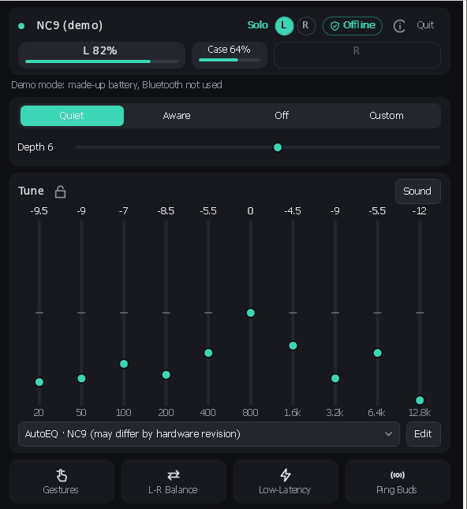
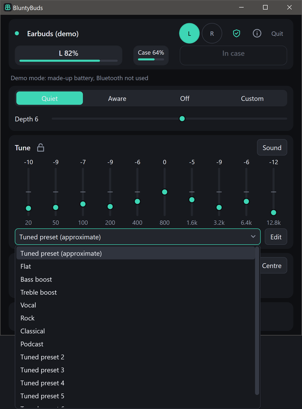
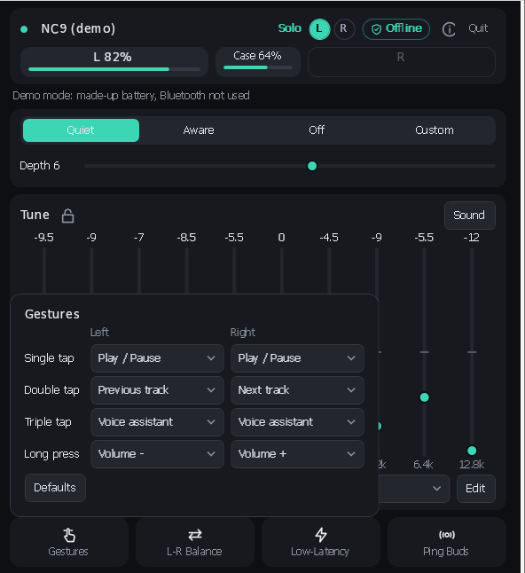
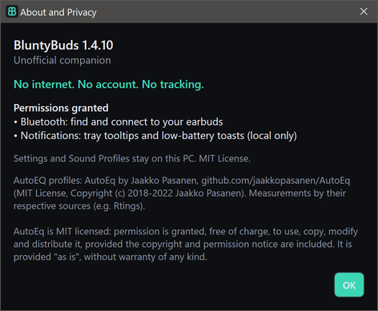
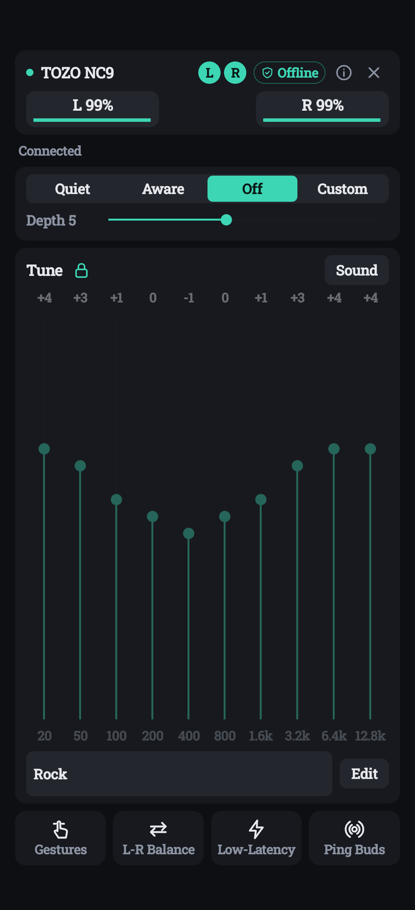
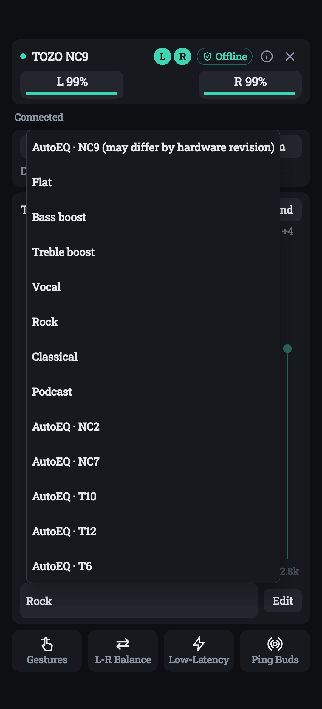
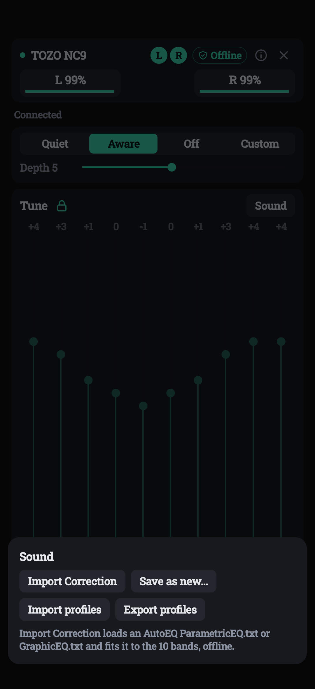

# BluntyBuds

Free, open-source, offline earbuds companion for Windows and Android: battery with Solo Mode, noise control,
a short 10-band EQ ("Tune") with Sound Profiles and a generic tuned preset, gestures, L-R Balance and Low-Latency
on the main screen, and Ping Buds. It talks to the earbuds directly over Bluetooth LE.

**No internet. No account. No tracking.** The Android app has no internet permission; the Windows app makes no network connections.
Unofficial companion. See [Compatibility](#compatibility) for supported earbuds.

## Install on Windows
Download from [Releases](https://github.com/arkivx0/BluntyBuds/releases/latest):
- **`BluntyBuds-<version>-setup.exe`** (installer, recommended): installs for your user without admin rights
  (into `%LOCALAPPDATA%\Programs\BluntyBuds`; an all-users install is offered too), adds a Start menu shortcut,
  an optional desktop icon, and an uninstaller in Apps & features. Newer versions upgrade in place.
  Uninstalling removes the Start with Windows entry and crash log and only closes the installed copy (a portable copy
  running elsewhere is left alone); your settings and presets are kept unless you choose to delete them.
- **`BluntyBuds-<version>-win-x64.exe`** (portable): a single self-contained exe, no install; run it from any folder.

Both need Windows 10 (19041) or later, x64. No .NET install required.

## Install on Android
Download **`BluntyBuds-<version>.apk`** from [Releases](https://github.com/arkivx0/BluntyBuds/releases/latest) and install it
(allow installs from your browser or file manager when asked). Android 10 or later. The app has no INTERNET permission.

## Features
- **Home on one screen**, dark and compact, no scrolling: device name, connection dot, L / Case / R battery pills (number plus bar)
  and a privacy badge on top. The badge is a shield, not a connection mark. Tap it for "Bluetooth only, no network, no analytics."
  Noise control and a short Tune sit in the middle. **L-R Balance** and **Low-Latency** are on the main screen.
  Gestures and Ping Buds stay as icon buttons (compact flyouts on Windows, sheets on Android). Controls the connected earbuds don't support are hidden.
- **Solo Mode**: when only one earbud is in use, the L/R chips (at least 40 px on Windows, 40 dp on Android) show which one,
  and the other pill reads **In case** instead of 0%. With no link, the pills read **Not connected**.
- **Single-earbud battery**: the notification, the Windows tray tooltip (e.g. "L 82%") and low-battery alerts use only the
  earbud in use; a missing bud is never reported as low or disconnected. The case level appears as its own pill, with the charging mark beside the percent so "Case 100%" is not clipped.
- **Noise**: Quiet, Aware, Off and Custom, with a Depth slider (1–10) where the earbuds support it.
- **Tune**: 10-band EQ (±12 dB), capped at about 160 px and never shorter than about 90 px, so the sliders stay usable when the window is short. Gain labels are whole numbers (the exact value is in the tooltip) and are sent as you change them.
  **Lock EQ** shows **Locked, tap to edit** and fades the sliders to 40%. The band labels stay at full contrast. The lock is remembered.
- **Sound Profiles**: a dropdown under Tune. Pick a profile and it applies at once, with a 3-second **Undo**.
  **Edit** next to it saves the current Tune as a new profile, or saves into, renames or deletes your own. Import and export as JSON (Sound).
- **Tuned preset**: built-in correction curves from the AutoEq project. The curve for the connected earbuds is named **Tuned preset**,
  or **Tuned preset (approximate)** when the hardware revision is not an exact match. Other built-in curves use generic numbered names. Names never include an earbud model. Curves never boost: the highest band is at most 0 dB.
- **Import Correction** (Sound): load any AutoEQ `ParametricEQ.txt` or `GraphicEQ.txt`, fitted to the 10 bands offline.
- **Gestures**: a small grid with one dropdown per gesture and side (single, double, triple tap, long press), only for the gestures
  your earbuds report. Changes are sent right away; Defaults restores the factory mapping.
- **L-R Balance** and **Low-Latency** (lower audio delay) are on the main screen. **Ping Buds** plays a loud chirp to find them.
- **About and Privacy**: "No internet. No account. No tracking.", the permissions actually granted, and "Unofficial companion".
  Battery pills and EQ sliders have accessibility names (percent, charging, and each band in Hz and dB).
- Windows: the window is 600×660 and does not shrink below that. The EQ gives up height first, down to about 90 px. Status text wraps to two lines, and the full message stays in a tooltip.
  Tray icon with battery tooltip and menu, low-battery toast, auto-reconnect, minimize/close to tray, optional Start with Windows,
  global hotkey **Ctrl+Alt+N** (cycle noise mode), per-device remembered Tune, dark title bar.
  If a scan finds nothing: "No earbuds found. Put them in pairing mode, then Scan."
- Android: the close button minimizes. Back still quits. The EQ stays at least about 90 dp on a normal screen, and only gets shorter when that is what keeps the other rows on screen. Labels use sp and shrink to fit instead of clipping when the system font is large.
  Edge-to-edge, fixed dark theme (no dynamic color), auto-reconnect, Quick Settings "Noise" tile,
  optional status notification (one battery bar for the earbud in use, small case figure, noise buttons), low-battery notification.

## Build
Windows (.NET 8): `cd windows/BluntyBuds.Win && dotnet publish -c Release -o ../publish`
Tests: `dotnet test windows/BluntyBuds.Proto.Tests`
Installer (Inno Setup 6): publish into `windows/installer/dist`, then `iscc windows/installer/BluntyBuds.iss`

Android (Gradle 8.9, AGP 8.5, SDK 35): `cd android && ./gradlew testReleaseUnitTest assembleRelease` (wrapper included)
Release signing is read from a properties file **outside** the repo:
`BLUNTYBUDS_KEYSTORE_PROPS=/path/to/keystore.properties` (keys: storeFile, storePassword, keyAlias, keyPassword).
Without it the release APK is built unsigned.

## Screenshots

### Windows
Windows, rendered in demo mode (made-up data, no Bluetooth, placeholder address).

### Android
Android on a phone.

  
  
  

## Compatibility

BluntyBuds works with TOZO earbuds that use protocol A or J (listed below). It is not affiliated with or endorsed by TOZO;
the name is used only to describe compatibility.

The model table (`ModelTable.g.cs` / `ModelTable.kt`) is plain data: advertised id code -> model name, chip family, protocol, features.
Detection uses the advertised id code first, then the Bluetooth name; the transport (protocol A or J) is confirmed from the GATT services on connect.
Only A1 and NC9 have been tested on real hardware; every other model shows "untested model" in the status line.

**Why some names (NC9, T6, T10, T6S, T10S, T9, T12, T20, NC9Pro ...) appear in both lists:** TOZO has shipped several
hardware revisions under the same name with different Bluetooth chips. Revisions on BES, JieLi, Bluetrum, WuQi, Realtek or
Actions chips use protocol A/J and are supported; revisions built on Airoha chips use a different classic-Bluetooth
transport that is not implemented yet. If you have an Airoha revision, the app connects but reports "no supported service".

Recognised (protocol hint): A1 (A/J), A3 (A), AeroSound (A), AeroSound2 (A), AeroSound3 (A), AeroSound4 (A), AeroSound6 (A), AeroSound6Pro (A), AgileDots (J), AgileDots2 (J), AgileNova (A), AgileSolo (A), AnybudsFits (A), AnybudsPro (A), ColorPods (A), CrystalPods (A), CrystalPods 2 (A), E1 (A), E2 (A), E2Pro (A), EvoScreen (A), G1 (A/J), G1S (J), GoldenX2Pro (A), H10 (A), H100BD (A), H20 (A), HA1 (A), HiFi (A), HT2 (A), HT3 (A), HT3V2 (A), NC20 (A), NC20Pro (A), NC3 (A), NC9 (A), NC9Pro (A), O2 (A), Openbuds (A), OpenEarRing (A), OpenEgo (A), OpenReal (J), OpenRhyme (A), OpenWear (A), OpenX2Pro (A), PA1 (A), PA2 (J), PE1 (A), PM1 (A), PM1V2 (A), QuietFit (A), SoundGo (A), T10 (A/J), T10S (A/J), T12 (A), T20 (J), T6 (A/J), T6S (A/J), T9 (J), T9S (J)

Not supported:
- charging case with screen, not earbuds: AeroSound6ProBox, ColorPodsBox, EvoScreenBox, GoldenX2ProBox, NC20ProBox, NC9ProBox, OpenX2ProBox
- Airoha (classic SPP/RACE via Airoha SDK): CrystalBuds, E20, E21, HT1, LD T20, NC2, NC2 Pro, NC2Pro, NC7, NC7Pro, NC9, NC9Plus, NC9Pro, NC9ProMax, T10, T10A6, T10S, T10S98, T10U, T10U8A, T10UAI, T12, T12miniUAI, T12SAA, T12U, T12UAI, T18, T18B, T18S, T20, T21, T6, T6A5, T6S, T6S97, T6U, T6U89, T6UAI, T9, TonalFits, TonalPods, X1, X2, Z6
- factory test build: OpenRhymeTest
- firmware-update mode id: OpenRealOTA

## Development
Run `BluntyBuds.exe --demo` to show the UI with made-up data (no Bluetooth, placeholder address) for screenshots.

## AutoEQ data
The built-in AutoEQ profiles (`windows/BluntyBuds.Proto/autoeq_profiles.tsv`, `android/app/src/main/assets/autoeq_profiles.tsv`)
are generated at development time by `tools/autoeq/gen_autoeq.py` from the results of
[AutoEq](https://github.com/jaakkopasanen/AutoEq) by Jaakko Pasanen (MIT License, Copyright (c) 2018-2022 Jaakko Pasanen;
measurements by their original sources, e.g. Rtings). Each GraphicEQ correction is sampled at the band centres
(20 Hz … 12.8 kHz), level-normalized, and solved for the device's peaking bands, then clamped to ±12 dB and rounded to 0.5 dB.
The apps themselves never go online. The idea of fitting AutoEQ profiles was inspired by
[tozo-eq](https://github.com/vvr3ddy/tozo-eq); no code was copied from it.

## License
MIT, see [LICENSE](LICENSE).
