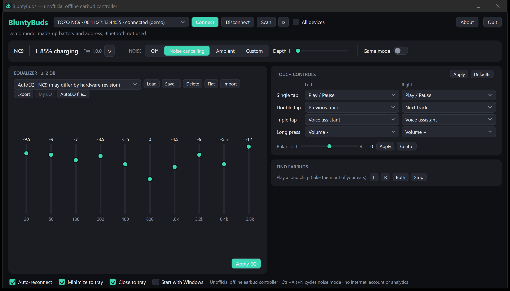
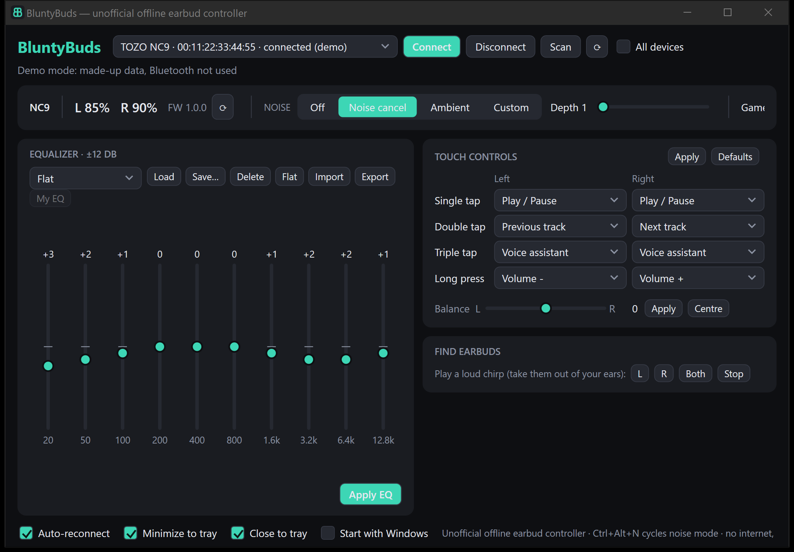

# BluntyBuds

Unofficial offline earbud controller for Windows and Android.
No internet permission, no account, no analytics, no auto-update.

Works with TOZO NC9 and A1; not affiliated with or endorsed by TOZO.

## Install on Windows
Download from [Releases](https://github.com/arkivx0/BluntyBuds/releases/latest):
- **`BluntyBuds-<version>-setup.exe`** (installer, recommended): installs for your user without admin rights
  (into `%LOCALAPPDATA%\Programs\BluntyBuds`; an all-users install is offered too), adds a Start menu shortcut,
  an optional desktop icon, and an uninstaller in Apps & features. Newer versions upgrade in place.
  Uninstalling removes the Start with Windows entry; your settings and presets are kept unless you choose to delete them.
- **`BluntyBuds-<version>-win-x64.exe`** (portable): a single self-contained exe, no install; run it from any folder.

Both need Windows 10 (19041) or later, x64. No .NET install required.

## Features
- Model auto-detection; only supported controls are shown
- Battery and firmware readout
- Noise control (Off / Noise cancelling / Ambient / Custom depth 1–10) on supported models
- Game mode, 10-band EQ with presets (import/export JSON), touch-control mapping, L/R balance
- AutoEQ: built-in correction profiles for models measured by the AutoEq project (the connected model's
  profile is listed first; all are selectable), and "Import AutoEQ file" for any AutoEQ `ParametricEQ.txt`
  or `GraphicEQ.txt`, fitted to the 10 bands offline
- "Find earbuds" chirp
- Windows: tray icon with battery, tray menu, low-battery toast, auto-reconnect, minimize to tray,
  optional Start with Windows, global hotkey **Ctrl+Alt+N** (cycle noise mode), per-device remembered EQ
- Android: auto-reconnect, Quick Settings "Noise" tile, optional status notification with noise buttons,
  low-battery notification

## Build
Windows (.NET 8): `cd windows/BluntyBuds.Win && dotnet publish -c Release -o ../publish`
Tests: `dotnet test windows/BluntyBuds.Proto.Tests`
Installer (Inno Setup 6): publish into `windows/installer/dist`, then `iscc windows/installer/BluntyBuds.iss`

Android (Gradle 8.9, AGP 8.5, SDK 35): `cd android && ./gradlew testReleaseUnitTest assembleRelease` (wrapper included)
Release signing is read from a properties file **outside** the repo:
`BLUNTYBUDS_KEYSTORE_PROPS=/path/to/keystore.properties` (keys: storeFile, storePassword, keyAlias, keyPassword).
Without it the release APK is built unsigned.

## Screenshots

## Model support

The model table (`ModelTable.g.cs` / `ModelTable.kt`) is plain data: advertised id code -> model name, chip family, protocol, features.
Detection uses the advertised id code first, then the Bluetooth name; the transport (protocol A or J) is confirmed from the GATT services on connect.
Only A1 and NC9 have been tested on real hardware; every other model shows "untested model" in the status line.

**Why some names (NC9, T6, T10, T6S, T10S, T9, T12, T20, NC9Pro ...) appear in both lists:** TOZO has shipped several
hardware revisions under the same name with different Bluetooth chips. Revisions on BES, JieLi, Bluetrum, WuQi, Realtek or
Actions chips use protocol A/J and are supported; revisions built on Airoha chips use a different classic-Bluetooth
transport that is not implemented yet. If you have an Airoha revision, the app connects but reports "no supported service".

Recognised (protocol hint): A1 (A/J), A3 (A), AeroSound (A), AeroSound2 (A), AeroSound3 (A), AeroSound4 (A), AeroSound6 (A), AeroSound6Pro (A), AgileDots (J), AgileDots2 (J), AgileNova (A), AgileSolo (A), AnybudsFits (A), AnybudsPro (A), ColorPods (A), CrystalPods (A), CrystalPods 2 (A), E1 (A), E2 (A), E2Pro (A), EvoScreen (A), G1 (A/J), G1S (J), GoldenX2Pro (A), H10 (A), H100BD (A), H20 (A), HA1 (A), HiFi (A), HT2 (A), HT3 (A), HT3V2 (A), NC20 (A), NC20Pro (A), NC3 (A), NC9 (A), NC9Pro (A), O2 (A), Openbuds (A), OpenEarRing (A), OpenEgo (A), OpenReal (J), OpenRhyme (A), OpenWear (A), OpenX2Pro (A), PA1 (A), PA2 (J), PE1 (A), PM1 (A), PM1V2 (A), QuietFit (A), SoundGo (A), T10 (A/J), T10S (A/J), T12 (A), T20 (J), T6 (A/J), T6S (A/J), T9 (J), T9S (J)

Not supported:
- charging case with screen, not earbuds: AeroSound6ProBox, ColorPodsBox, EvoScreenBox, GoldenX2ProBox, NC20ProBox, NC9ProBox, OpenX2ProBox
- Airoha (classic SPP/RACE via Airoha SDK): CrystalBuds, E20, E21, HT1, LD T20, NC2, NC2 Pro, NC2Pro, NC7, NC7Pro, NC9, NC9Plus, NC9Pro, NC9ProMax, T10, T10A6, T10S, T10S98, T10U, T10U8A, T10UAI, T12, T12miniUAI, T12SAA, T12U, T12UAI, T18, T18B, T18S, T20, T21, T6, T6A5, T6S, T6S97, T6U, T6U89, T6UAI, T9, TonalFits, TonalPods, X1, X2, Z6
- factory test build: OpenRhymeTest
- firmware-update mode id: OpenRealOTA

## Development
Run `BluntyBuds.exe --demo` to show the UI with made-up data (no Bluetooth, placeholder address) for screenshots.

## AutoEQ data
The built-in AutoEQ profiles (`windows/BluntyBuds.Proto/autoeq_profiles.tsv`, `android/app/src/main/assets/autoeq_profiles.tsv`)
are generated at development time by `tools/autoeq/gen_autoeq.py` from the results of
[AutoEq](https://github.com/jaakkopasanen/AutoEq) by Jaakko Pasanen (MIT License, Copyright (c) 2018-2022 Jaakko Pasanen;
measurements by their original sources, e.g. Rtings). Each GraphicEQ correction is sampled at the band centres
(20 Hz … 12.8 kHz), level-normalized, and solved for the device's peaking bands, then clamped to ±12 dB and rounded to 0.5 dB.
The apps themselves never go online. The idea of fitting AutoEQ profiles was inspired by
[tozo-eq](https://github.com/vvr3ddy/tozo-eq); no code was copied from it.

## License
MIT, see [LICENSE](LICENSE).
